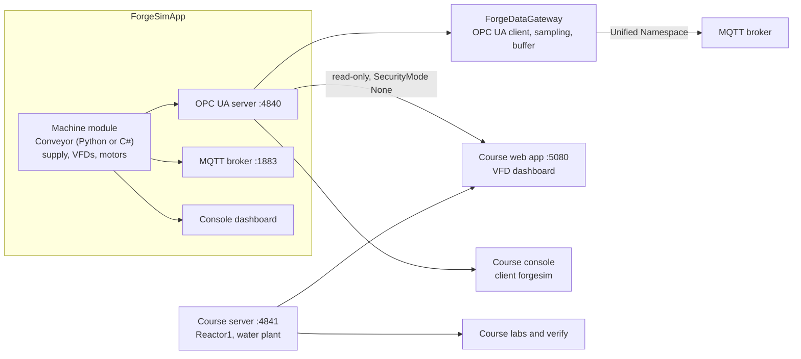

# Architecture

The repository holds three things that work together: a **simulator** (`ForgeSimApp` with its device and machine libraries), a **data gateway** (`ForgeDataGateway*`) and an **OPC UA course** (`src/OpcUaCourse`). Details of each are in the [README](../README.md), [CONVEYOR.md](../CONVEYOR.md), [FORGE-DATA-GATEWAY.md](../FORGE-DATA-GATEWAY.md) and [docs/opcua-course/ARCHITECTURE.md](opcua-course/ARCHITECTURE.md). This page is the map between them.

## Solution map

`src/ForgeIndustrial.slnx` groups the projects in folders:

| Folder | Projects |
|---|---|
| `/Core` | `IndustrialSimLib`: bindables, simulation state, events, `IMachineModule`, `IProtocolAdapter` |
| `/Devices` | `ThreePhaseSupplySimLib`, `VfdSimLib`, `InductionMotorLib`, `PackageSimLib` |
| `/Machines` | `ConveyorSimLib`: `ConveyorMachine` (C#) and `ConveyorPySharpMachine` (Python port, default) |
| `/Protocols` | `OpcUaServerLib`, `MqttServerLib`, `ConsoleDashboardLib` |
| `/Applications` | `ForgeSimApp` |
| `/ForgeDataGateway/...` | `ForgeDataGatewayCore`, `ForgeDataGatewayApp`, `ForgeDataGatewayCli` |
| `/OpcUaCourse` | `UaCourse` (server and console labs), `UaCourse.Web` (Blazor), `UaCourse.DynamicClient` |
| `/Tests` | `IndustrialSim.Tests`, `ForgeDataGatewayTests` |

## Data flow

Two OPC UA servers exist on purpose: ForgeSim's is *generic* (every tag becomes a read-only variable under folders), the course's is a small *modelled* one (ObjectTypes, units, methods, events). Lesson 19 compares them.

## Rules that hold the pieces together

- **Parity.** The physics of the supply, the VFD and the motor exists twice: in the C# device libraries and in `ConveyorSimLib/Scripts/conveyor_machine.py`. Any change the Conveyor can reach must be made in both; `ConveyorParityTests` compares every tag of the two machines after stepping them identically (including a stop that makes the motors regenerate) and fails if they drift. Device features the Conveyor never uses (the VFD control terminals) are C#-only.
- **Protocol neutrality.** Machines expose `SimulationTag`s; adapters map tags to their wire format. No machine knows a protocol and no adapter knows a machine.
- **Build output** is outside the repository (`Directory.Build.props`), and so is everything the course generates (certificates, keys, NodeSet2).
- **Language.** Documents, comments, UI texts and commits are in English.

## VFD model

Concepts, wiring, a model-coverage table and the planned gaps: [docs/vfd/VFD.md](vfd/VFD.md). Supply-side protection compared with what is simulated: [docs/vfd/SUPPLY-PROTECTION.md](vfd/SUPPLY-PROTECTION.md). Reference infographics (third-party, kept local): [docs/images/vfd/SOURCES.md](images/vfd/SOURCES.md).

## Tests

`dotnet test src/ForgeIndustrial.slnx` covers the core, the devices (including DC bus, regeneration with and without a braking resistor, control terminals), the Conveyor and the C#/Python parity, and the data gateway. The course has its own end-to-end check: `UaCourse verify` runs 13 labs against a real TCP server. There is no automated test for the OPC UA adapter of ForgeSim itself; the `client forgesim` lab is the closest thing and is run by hand.
