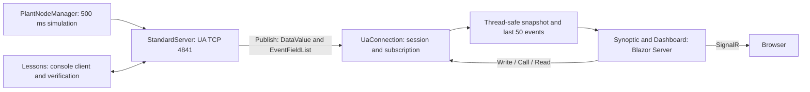

# Architecture

## Data flow



The simulation lives in the server, not in the browser. A label does not generate a periodic Read request: the data is queued by the MonitoredItems and delivered through Publish. The 500 ms UI timer renders the snapshot that has already been received; it does not query OPC UA.

## Responsibilities

| Module | Responsibility |
|---|---|
| `UaCourse/Configuration.cs` | UA configuration, certificates, endpoint, local trust, artifacts root |
| `UaCourse/PlantServer.cs` | Server, NodeManager, address space, simulation, methods, events |
| `UaCourse/Lessons.cs` | Teaching client and assertions of the UA services |
| `UaCourse/Labs/*.cs` | Separate implementations of the labs and executable solutions |
| `UaCourse/Models/RecipeData.cs` | Encodeable contract and validation of the custom recipe |
| `UaCourse/Models/RecipeNodeModel.cs` | Public type, encoding, LoadRecipe and partial NodeSet2 export |
| `UaCourse.DynamicClient` | Independent dynamic decoder, with no reference to the server DLL |
| `UaCourse.Web/Modules/ScreenCatalog.cs` | Declarative catalog of screens and bindings |
| `UaCourse.Web/Services/UaConnection.cs` | Shared session, monitored items, events, retry and commands |
| `UaCourse.Web/Components/Synoptic.razor` | Background and percentage labels, quality and timestamp |
| `UaCourse.Web/Components/Pages/Home.razor` | Neutral index and dashboard links generated from the catalog |
| `UaCourse.Web/Components/Layout/MainLayout.razor` | UA Lab template and shared navigation generated from the catalog |
| `UaCourse.Web/Components/Pages/Dashboard.razor` | Route-based selection, commands, results and circuit lifecycle |

The projects live under `src/OpcUaCourse/`. The web app references the console project to reuse configuration and helpers. This is an explicit simplification of the first version; extracting a `UaCourse.Protocol` library is the next step when the modules grow. The boundaries are already expressed by classes and namespaces.

## Navigation and template

The home page (`/` and `/dashboards`) uses static rendering; `/dashboards/{ScreenId}` uses Interactive Server and resolves the screen in the catalog. The routes also work with direct access and reload. An unknown ID produces an explicit view without a synoptic. `course.css` defines the local template with no external UI dependencies. Adding a screen to the catalog updates the home page and the menu without changing the pages. The UA session remains a shared service of the application, active even when the browser shows the home page.

## Information model

Stable application namespace: `urn:uacourse:plant`. The client resolves the index from the NamespaceArray of each session; it does not assume `ns=2`.

```text
Objects
└─ Plant (FolderType)
   ├─ Reactor1 (ReactorType)
   │  ├─ Temperature: Double, read only
   │  │  └─ EngineeringUnits: EUInformation (HasProperty)
   │  ├─ Setpoint: Double, read/write, 20..90
   │  ├─ Running: Boolean, read only
   │  ├─ Profile: Double[], read only
   │  ├─ Recipe: Range in ExtensionObject, read only
   │  ├─ BatchRecipe: custom RecipeDataType, read only
   │  ├─ LoadRecipe(Recipe: RecipeDataType) -> AcceptedRevision: UInt32
   │  ├─ Start() -> Accepted: Boolean
   │  ├─ Stop()
   │  └─ ApplyRecipe(Target: Double) -> Target: Double
   └─ WaterPlant (BaseObjectType)
      └─ 20 Double signals: flows, levels, pressures, totalizer
```

`ReactorType` derives from `BaseObjectType` and declares `Temperature` as Mandatory; the other properties are extensions to be declared in the full contract. `Recipe` keeps the standard Range of lesson 08. `BatchRecipe` uses RecipeDataType with Name, Revision, Target and Steps: StructureDefinition and HasEncoding are public. Encode/Decode are manual and consistent with the metadata; DynamicClient verifies decoding without RecipeData. LoadRecipe validates, keeps a clone and updates the target, but does not run a timed sequence of the steps. The exported NodeSet2 contains the type and the encoding, not the whole versioned address space.

The reactor follows the setpoint with a discrete first-order response. The water quantities oscillate synthetically; the totalizer grows by 30.4 gal every 500 ms while running (about 3650 GPM). There is no hydraulic balance and no independent control of the ten pumps in the drawing.

## Concurrency and lifecycle

The NodeManager protects updates and methods with its Lock. The SDK handles the operations on the nodes. The callbacks notify changes through `ClearChangeMasks`.

`UaConnection` is a singleton and a hosted service. It creates one subscription shared by all circuits: the number of sessions is independent of the number of browsers. Snapshots use a ConcurrentDictionary; events use a queue limited to 50 items. A SemaphoreSlim serializes commands and teardown. No UA callback calls the Blazor renderer directly.

On a failed KeepAlive the service closes the session, empties the snapshot and recreates session and subscription after 3 seconds. It does not transfer subscriptions: events can be lost between sessions. The circuit cancels its own timer in DisposeAsync. The UI disables the commands when offline and shows `—`, without passing the last value off as valid data.

## Security and boundaries

The UA channel uses Basic256Sha256/SignAndEncrypt. Local certificates are generated under `<artifacts root>/pki`; only the exact DER of the peer found in the other application's folder is accepted, and only for BadCertificateUntrusted. This convention makes the lab easy on a single machine and does not replace the management of trust lists.

The user identity is Anonymous; channel encryption and user authorization are separate topics. The web app implements no authentication and all browsers share the UA identity. Use it on localhost for this lab. HTTPS, users, roles and per-circuit authorization are future development, not implicit features.

The lab's ASP.NET DataProtection keys are saved in `<artifacts root>/aspnet-keys`, isolating the project from the Windows profile store. The local store does not configure encryption of the keys at rest: for operational hosting explicit protection is needed, and a shared store for multiple instances. Logging goes to the console, with no dependency on the Windows Event Log. The artifacts root is `UACOURSE_ARTIFACTS_ROOT` or, by default, `%LOCALAPPDATA%\UaCourse`, so that console and web share the same PKI regardless of the working directory and nothing, private keys included, is ever written inside the repository.
