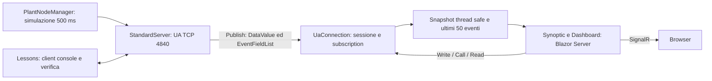

# Architettura

## Flusso dei dati



La simulazione vive nel server, non nel browser. Una label non genera una richiesta Read periodica: i dati sono accodati dai MonitoredItem e consegnati attraverso Publish. Il timer UI di 500 ms rende lo snapshot già ricevuto; non interroga OPC UA.

## Responsabilità

| Modulo | Responsabilità |
|---|---|
| `UaCourse/Configuration.cs` | Configurazione UA, certificati, endpoint, trust locale |
| `UaCourse/PlantServer.cs` | Server, NodeManager, address space, simulazione, metodi, eventi |
| `UaCourse/Lessons.cs` | Client didattico e asserzioni dei servizi UA |
| `UaCourse/Labs/*.cs` | Implementazioni separate dei laboratori e soluzioni eseguibili |
| `UaCourse/Models/RecipeData.cs` | Contratto encodeable e validazione della ricetta custom |
| `UaCourse/Models/RecipeNodeModel.cs` | Tipo pubblico, encoding, LoadRecipe ed export NodeSet2 parziale |
| `UaCourse.DynamicClient` | Decoder dinamico indipendente, senza riferimento alla DLL del server |
| `UaCourse.Web/Modules/ScreenCatalog.cs` | Catalogo dichiarativo di schermate e binding |
| `UaCourse.Web/Services/UaConnection.cs` | Sessione condivisa, monitored item, eventi, retry e comandi |
| `UaCourse.Web/Components/Synoptic.razor` | Sfondo e label percentuali, qualità e timestamp |
| `UaCourse.Web/Components/Pages/Home.razor` | Indice neutro e link alle dashboard generati dal catalogo |
| `UaCourse.Web/Components/Layout/MainLayout.razor` | Template UA Lab e navigazione condivisa generata dal catalogo |
| `UaCourse.Web/Components/Pages/Dashboard.razor` | Selezione tramite rotta, comandi, risultati e lifecycle del circuito |

La web app referenzia il progetto console per riusare configurazione e helper. È una semplificazione esplicita della prima versione; estrarre una libreria `UaCourse.Protocol` è il prossimo passo quando crescono i moduli. I confini sono già espressi da classi e namespace.

## Navigazione e template

La home (`/` e `/dashboards`) usa rendering statico; `/dashboards/{ScreenId}` usa Interactive Server e risolve la schermata nel catalogo. Le rotte funzionano anche con accesso diretto e reload. Un ID sconosciuto produce una vista esplicita senza sinottico. `course.css` definisce il template locale senza dipendenze UI esterne. Aggiungere una schermata al catalogo aggiorna home e menu senza modificare le pagine. La sessione UA rimane un servizio condiviso dell'applicazione, attivo anche quando il browser mostra la home.

## Modello informativo

Namespace applicativo stabile: `urn:uacourse:plant`. Il client risolve l'indice dalla NamespaceArray di ogni sessione; non assume `ns=2`.

```text
Objects
└─ Plant (FolderType)
   ├─ Reactor1 (ReactorType)
   │  ├─ Temperature: Double, read only
   │  │  └─ EngineeringUnits: EUInformation (HasProperty)
   │  ├─ Setpoint: Double, read/write, 20..90
   │  ├─ Running: Boolean, read only
   │  ├─ Profile: Double[], read only
   │  ├─ Recipe: Range in ExtensionObject, read only
   │  ├─ BatchRecipe: RecipeDataType custom, read only
   │  ├─ LoadRecipe(Recipe: RecipeDataType) -> AcceptedRevision: UInt32
   │  ├─ Start() -> Accepted: Boolean
   │  ├─ Stop()
   │  └─ ApplyRecipe(Target: Double) -> Target: Double
   └─ WaterPlant (BaseObjectType)
      └─ 20 segnali Double: portate, livelli, pressioni, totalizzatore
```

`ReactorType` deriva da `BaseObjectType` e dichiara `Temperature` Mandatory; le altre proprietà sono estensioni da dichiarare nel contratto completo. `Recipe` conserva il Range standard della lezione 08. `BatchRecipe` usa RecipeDataType con Name, Revision, Target e Steps: StructureDefinition e HasEncoding sono pubblici. Encode/Decode sono manuali e coerenti con i metadati; DynamicClient verifica decoding senza RecipeData. LoadRecipe valida, conserva un clone e aggiorna il target, ma non esegue una sequenza temporizzata degli step. Il NodeSet2 esportato contiene tipo ed encoding, non l'intero address space versionato.

Il reattore segue il setpoint con un primo ordine discreto. Le grandezze idriche oscillano sinteticamente; il totalizzatore cresce di 30.4 gal ogni 500 ms in marcia (circa 3650 GPM). Non c'è bilancio idraulico né controllo indipendente delle dieci pompe disegnate.

## Concorrenza e lifecycle

Il NodeManager protegge aggiornamenti e metodi con il suo Lock. Lo SDK gestisce le operazioni sui nodi. I callback notificano i cambi tramite `ClearChangeMasks`.

`UaConnection` è singleton e hosted service. Crea una subscription condivisa per tutti i circuiti: numero di sessioni indipendente dal numero di browser. Gli snapshot usano ConcurrentDictionary; gli eventi una coda limitata a 50 elementi. Un SemaphoreSlim serializza comandi e teardown. Nessun callback UA invoca direttamente il renderer Blazor.

Al KeepAlive fallito il servizio chiude la sessione, svuota lo snapshot e ricrea sessione e subscription dopo 3 secondi. Non trasferisce subscription: tra le sessioni è possibile perdere eventi. Il circuito cancella il proprio timer alla DisposeAsync. La UI disabilita i comandi quando offline e mostra `—` senza spacciare l'ultimo valore per un dato valido.

## Sicurezza e confini

Il canale UA usa Basic256Sha256/SignAndEncrypt. I certificati locali vengono generati sotto `.artifacts/pki`; è accettato solo il DER esatto del peer presente nella cartella dell'altra applicazione, e solo per BadCertificateUntrusted. Questa convenzione facilita il laboratorio sulla stessa macchina e non sostituisce la gestione delle trust list.

L'identità utente è Anonymous; cifratura del canale e autorizzazione utente sono temi distinti. La web app non implementa autenticazione e tutti i browser condividono l'identità UA. Usare su localhost per questo laboratorio. HTTPS, utenti, ruoli e autorizzazioni per circuito sono sviluppo futuro, non funzionalità implicite.

Le chiavi ASP.NET DataProtection del laboratorio sono salvate in `.artifacts/aspnet-keys`, isolando il progetto dallo store del profilo Windows. Lo store locale non configura cifratura delle chiavi a riposo: per hosting operativo serve protezione esplicita e per più istanze uno store condiviso. Il logging va alla console, senza dipendenza dal Windows Event Log. La root del repository viene individuata risalendo dalla directory dell'assembly alla solution, così console e web condividono lo stesso PKI; fuori dal repository si usa la working directory.
