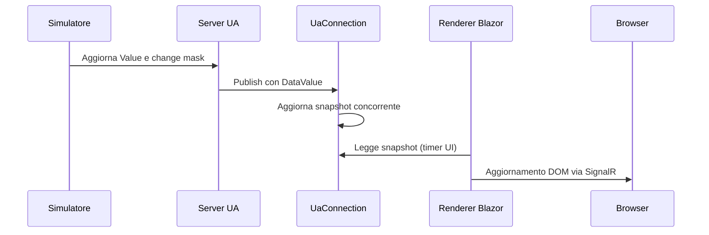

# Sinottici modulari e lifecycle Blazor

## Concetti

Il browser non apre socket opc.tcp: il backend ASP.NET mantiene il client UA e distribuisce lo stato al circuito Blazor. Un catalogo separa coordinate e nomi dei nodi dalla logica del protocollo. Il rendering aggiorna la vista, la subscription aggiorna lo snapshot. Sono due frequenze differenti.

## Esperimento

Apri due browser e cambia schermata. Osserva che una sola UaConnection sottoscrive i nodi distinti di tutti i sinottici. Avvia un comando in una finestra e vedi il nuovo valore nell'altra.

## Nel codice C#

ScreenCatalog contiene il binding. Synoptic posiziona label percentuali su SVG. Dashboard cancella il PeriodicTimer alla DisposeAsync e usa InvokeAsync per il renderer. Il servizio non conserva riferimenti ai componenti.

## Esercizio e verifica

Aggiungi una terza schermata con un nuovo sfondo e due nodi; nessuna modifica al client UA. Poi definisci un modello CommandDefinition per hotspot e conferma dell'esito.

## Errore da evitare

Lo snapshot è condiviso tra utenti: nella prima versione non c'è isolamento o autorizzazione per circuito. Stato connesso non equivale a freschezza del singolo sensore.

## Obiettivi e laboratorio

Tempo indicativo: 120 minuti. Segui [UaConnection.cs](../../src/UaCourse.Web/Services/UaConnection.cs), [ScreenCatalog.cs](../../src/UaCourse.Web/Modules/ScreenCatalog.cs) e [Dashboard.razor](../../src/UaCourse.Web/Components/Pages/Dashboard.razor). Devi saper aggiungere un sinottico senza duplicare il protocollo e distinguere il lifecycle del circuito da quello della sessione UA.

## Il percorso completo di una label



Il timer UI non misura la temperatura. Il valore può essere ricevuto prima che venga renderizzato; ritardo del renderer e ritardo della sorgente non sono la stessa metrica.

UaConnection è singleton/hosted service e sopravvive ai circuiti. Dashboard è un componente per circuito e possiede soltanto il proprio PeriodicTimer. Chiudere una scheda non deve chiudere la sessione UA condivisa e interrompere gli altri browser.

## Modulo grafico dichiarativo

```csharp
new ScreenDefinition(
    "line2", "Linea 2", "Seconda linea",
    "/screens/line2.svg",
    [new SignalLabel("Line2.Speed", "Velocità", "rpm", 50, 30)])
{
    Commands = [new ScreenCommand("Avvia", "Start", 25, 55)]
};
```

Il binding della label include identificatore del nodo, didascalia, unità e posizione. La posizione è percentuale sul canvas, non sulla finestra. Lo sfondo non contiene valori statici che competano con le label.

Attenzione al comando dell'esempio: ScreenCommand corrente conserva soltanto il nome metodo e UaConnection.CallAsync assume Reactor1. Aggiungere un hotspot non lo rende automaticamente un comando di Line2. Per istanze diverse estendi il contratto grafico con ObjectId/MethodId, argomenti e policy autorizzative.

## Callback e concorrenza

I callback SDK possono arrivare fuori dal contesto del renderer. Il servizio aggiorna ConcurrentDictionary e ConcurrentQueue; il componente richiama StateHasChanged tramite InvokeAsync. Non accedere direttamente ai componenti da un callback UA.

Un comando usa SemaphoreSlim per coordinarsi con il teardown della sessione. Il pulsante viene disabilitato durante l'attesa; l'errore resta visibile nell'output. Il server conserva comunque la validazione perché browser e altri client possono inviare richieste concorrenti.

## Prerender e asset: un problema reale del laboratorio

La prima risposta HTTP può contenere HTML prerenderizzato prima dell'attivazione SignalR. Un pulsante visibile non implica che il circuito sia già pronto. Dashboard abilita i comandi dopo OnAfterRender(firstRender).

Con avvio --no-launch-profile il template girava in Production senza caricare gli static web assets di build: la pagina rispondeva 200, gli script Blazor 500. Program.cs abilita UseStaticWebAssets. Il test browser ha rilevato il difetto che il solo smoke HTTP non rilevava.

## Esercizio risolto: aggiungere una schermata

Aggiungi uno sfondo, una definizione e due nodi server. Verifica che UaConnection crei gli item tramite SelectMany/Distinct senza una nuova sessione per schermata.

**Soluzione.** Il catalogo è fonte dei binding, Synoptic è il renderer comune e il servizio sottoscrive i nodi di tutte le schermate. Sul mobile il canvas mantiene 1000 px e scorre dentro il suo contenitore; comandi ed eventi si adattano alla larghezza della pagina.

**Verifica.** Esegui [check-layout.cjs](../../scripts/check-layout.cjs): cambio schermata, collisioni, overflow e comandi sono controlli distinti. Il controllo geometrico tra label non prova la correttezza semantica del binding né garantisce che nessuna label copra una scritta dello sfondo; occorre anche ispezione visiva.

Riferimento SDK: [UA-.NETStandard, release usata](https://github.com/OPCFoundation/UA-.NETStandard/tree/1.5.374.158).

[Indice](README.md) · [Uso dei sample](../USAGE.md) · [Architettura](../ARCHITECTURE.md)
