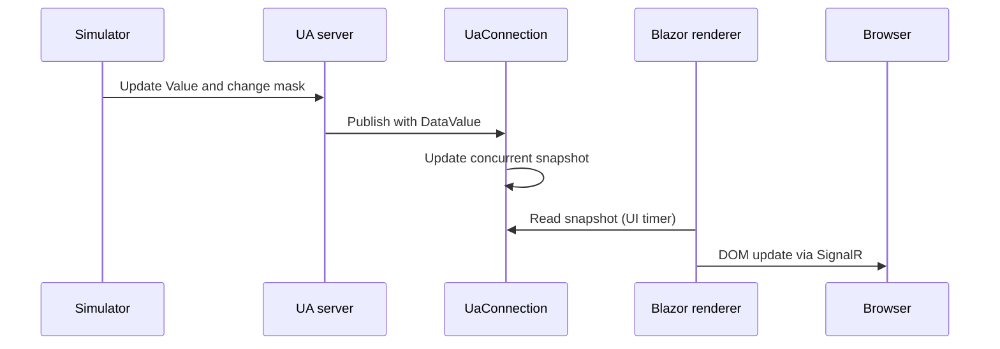

# Modular synoptics and the Blazor lifecycle

## Concepts

The browser does not open opc.tcp sockets: the ASP.NET backend keeps the UA client and distributes the state to the Blazor circuit. A catalog separates coordinates and node names from the protocol logic. Rendering updates the view, the subscription updates the snapshot. These are two different rates.

## Experiment

Open two browsers and change screen. Observe that a single UaConnection subscribes to the distinct nodes of all the synoptics. Start a command in one window and see the new value in the other.

## In the C# code

ScreenCatalog contains the binding. Synoptic places percentage labels on an SVG. Dashboard cancels the PeriodicTimer in DisposeAsync and uses InvokeAsync for the renderer. The service keeps no references to the components.

## Exercise and verification

Add a third screen with a new background and two nodes; no change to the UA client. Then define a CommandDefinition model per hotspot and for confirming the outcome.

## Mistake to avoid

The snapshot is shared among users: in the first version there is no isolation or authorization per circuit. A connected state is not the same as the freshness of a single sensor.

## Goals and lab

Estimated time: 120 minutes. Follow [UaConnection.cs](../../../src/OpcUaCourse/UaCourse.Web/Services/UaConnection.cs), [ScreenCatalog.cs](../../../src/OpcUaCourse/UaCourse.Web/Modules/ScreenCatalog.cs) and [Dashboard.razor](../../../src/OpcUaCourse/UaCourse.Web/Components/Pages/Dashboard.razor). You must be able to add a synoptic without duplicating the protocol and to tell the lifecycle of the circuit from that of the UA session.

## The complete path of a label



The UI timer does not measure the temperature. The value can be received before it is rendered; renderer delay and source delay are not the same metric.

UaConnection is a singleton/hosted service and outlives the circuits. Dashboard is a component per circuit and owns only its own PeriodicTimer. Closing a tab must not close the shared UA session and interrupt the other browsers.

## Declarative graphic module

```csharp
new ScreenDefinition(
    "line2", "Line 2", "Second line",
    "/screens/line2.svg",
    [new SignalLabel("Line2.Speed", "Speed", "rpm", 50, 30)])
{
    Commands = [new ScreenCommand("Start", "Start", 25, 55)]
};
```

The binding of the label includes node identifier, caption, unit and position. The position is a percentage of the canvas, not of the window. The background contains no static values that compete with the labels.

Beware of the command in the example: the current ScreenCommand keeps only the method name and UaConnection.CallAsync assumes Reactor1. Adding a hotspot does not automatically make it a command of Line2. For different instances extend the graphic contract with ObjectId/MethodId, arguments and authorization policies.

## Callbacks and concurrency

SDK callbacks can arrive outside the context of the renderer. The service updates a ConcurrentDictionary and a ConcurrentQueue; the component calls StateHasChanged through InvokeAsync. Do not access the components directly from a UA callback.

A command uses a SemaphoreSlim to coordinate with the teardown of the session. The button is disabled during the wait; the error remains visible in the output. The server keeps its validation anyway because browsers and other clients can send concurrent requests.

## Prerender and assets: a real problem of the lab

The first HTTP response can contain HTML prerendered before SignalR is activated. A visible button does not imply that the circuit is already ready. Dashboard enables the commands after OnAfterRender(firstRender).

With the start --no-launch-profile the template ran in Production without loading the static web assets of the build: the page answered 200, the Blazor scripts 500. Program.cs enables UseStaticWebAssets. The browser test detected the defect that the HTTP smoke test alone did not.

## Solved exercise: adding a screen

Add a background, a definition and two server nodes. Verify that UaConnection creates the items through SelectMany/Distinct without a new session per screen.

**Solution.** The catalog is the source of the bindings, Synoptic is the common renderer and the service subscribes to the nodes of all the screens. On mobile the canvas keeps 1000 px and scrolls inside its container; commands and events adapt to the width of the page.

**Verification.** Run [check-layout.cjs](../../../src/OpcUaCourse/scripts/check-layout.cjs): screen change, collisions, overflow and commands are distinct checks. The geometric check between labels does not prove the semantic correctness of the binding nor guarantee that no label covers a text of the background; a visual inspection is also needed.

SDK reference: [UA-.NETStandard](https://github.com/OPCFoundation/UA-.NETStandard) (package version 1.5.376.244).

[Index](README.md) · [Using the samples](../USAGE.md) · [Architecture](../ARCHITECTURE.md)
