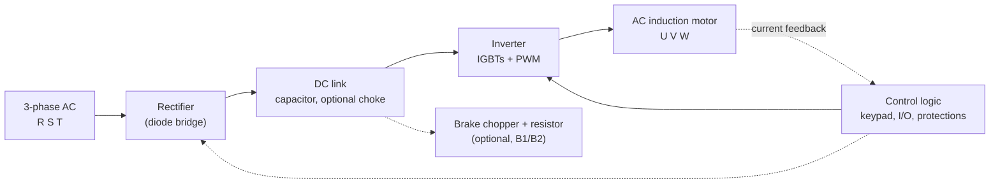

# Variable frequency drives (VFD) and how the simulator models them

A variable frequency drive controls the speed and torque of an AC induction motor by changing the frequency and the voltage it supplies. This page explains the concepts and then states, for each one, whether `VfdSimLib` models it. The device model is described in the [README](../../README.md#device-models-simplified-physics) and used by the [Conveyor](../../CONVEYOR.md).

Reference material used to prepare this page is listed in [images/vfd/SOURCES.md](../images/vfd/SOURCES.md) (third-party infographics, kept local). Everything below is written and drawn independently.

## 1. Speed, frequency and V/f

The rotating field of the stator turns at the synchronous speed

```text
Ns = 120 · f / P        (rpm; f in Hz, P = number of poles)
```

A 4-pole motor on 50 Hz has Ns = 1500 rpm. The rotor runs a little slower; the difference is the **slip** (a few percent at rated load). Changing `f` therefore changes the speed.

The stator flux is proportional to `V / f`. If the drive lowered `f` and kept `V` constant, the flux would saturate the iron and the motor would overheat; if it lowered `V` more than `f`, the flux and the torque would drop. Scalar control keeps `V/f` constant up to the base frequency, so the motor can deliver rated torque at any speed below base speed (constant-torque region). Above the base frequency the drive cannot raise `V` beyond the supply, so the flux falls and the available torque falls with `1/f` (field-weakening, constant-power region). At very low frequency the stator resistance drops a noticeable share of the voltage, so drives add a **voltage boost**.

## 2. Power stages



1. **Rectifier.** A six-diode bridge turns the three phases into a pulsating DC voltage. The average of an ideal six-pulse bridge is about `1.35 × V_LL`.
2. **DC link.** Capacitors (often with a choke) smooth the ripple and store energy. With little load the capacitors charge towards the **peak** of the line voltage, `√2 × V_LL ≈ 1.414 × V_LL`; under load the bus sits between the two values. For a 400 V supply: about 566 V at no load, about 540 V at full load.
3. **Inverter.** Six IGBTs switch the DC bus at a few kHz. With **pulse width modulation (PWM)** the width of the pulses is varied so that the motor winding, which filters the current, sees an approximately sinusoidal current of the wanted frequency and amplitude.
4. **Control.** A microprocessor sets the PWM from the speed reference, ramps, limits and feedback, and handles the protections, the keypad and the terminals.

## 3. Control strategies

| Strategy | What it controls | Typical use | Simulator |
|---|---|---|---|
| V/f (scalar) | Frequency and voltage, open loop, with a boost at low speed | Pumps, fans, conveyors | **Used** (`Vfd.Step`) |
| Vector / field-oriented (FOC) | Splits stator current into flux and torque components, regulates both | Machine tools, hoists, precise low-speed torque | Not modelled |
| Direct torque control (DTC) | Stator flux and torque directly, with very fast torque response | Demanding dynamics | Not modelled |

## 4. Drive topologies

| Type | DC link | Output | Notes |
|---|---|---|---|
| Voltage source inverter (VSI) | Constant voltage (capacitor) | Variable voltage and frequency, PWM | Most common; general purpose |
| Current source inverter (CSI) | Constant current (large inductor) | Variable current | Medium and high power, robust against short circuits, can regenerate |
| Regenerative / active front end (AFE) | Controlled DC bus | PWM | Returns braking energy to the grid, low harmonics, higher cost |

"PWM" is sometimes listed as a separate drive type in popular material. It is a modulation technique that nearly all VSIs use, not a distinct topology. The simulator models a generic VSI with a diode front end.

## 5. Wiring and I/O of a compact drive

The terminals below are those of a typical compact drive (for example the Delta MS300 series); other brands use different names but the same functions.

| Function | Terminals | Notes |
|---|---|---|
| Power input | R/L1, S/L2, T/L3, PE | Three-phase supply; the PE connection is mandatory |
| Motor output | U/T1, V/T2, W/T3 | Never connect the supply to these |
| Braking resistor | B1, B2 (or +/−) | Dissipates regenerated energy when the bus rises during deceleration |
| Digital inputs | DI1…DI6, common DCM | Forward run, reverse run, multi-step speeds, fault reset, external fault |
| Analog speed reference | AVI, +10 V, ACM | 0–10 V (potentiometer) or 4–20 mA |
| Relay output | RA / RB / RC | Normally a fault contact (one contact normally open, one normally closed) |
| Analog output | AFM, ACM | 0–10 V proportional to output frequency or another quantity |

Order of precedence for the speed reference on most drives: multi-step digital selection, then the analog input, then the keypad.

## 6. Benefits

- **Energy.** For centrifugal pumps and fans the power varies with the cube of the speed (affinity laws): running at 80 % speed takes about 51 % of the power.
- **Soft start and stop.** Controlled acceleration and deceleration ramps remove the large starting current and the mechanical shock.
- **Process control.** Speed follows a reference or a controller, so the process can be regulated directly.
- **Equipment life.** Lower mechanical and electrical stress on the motor, the gearbox and the couplings.

## 7. Common issues and protections

| Issue | Cause | Protection or remedy |
|---|---|---|
| Overheating | Blocked airflow, failed fan, high ambient temperature, overload | Heatsink temperature trip, derating, cleaning, cooling |
| Overvoltage | Supply surge, or regenerated energy raising the DC bus on fast deceleration | Longer deceleration, braking chopper and resistor, regenerative drive |
| Undervoltage | Supply sag or short interruption | Undervoltage trip, ride-through function |
| Overcurrent / short circuit | Overload, jam, wrong parameters, cable fault | Current limit and trip |
| Ground fault | Insulation failure in cable or motor | Ground-fault trip |
| Phase loss | Blown fuse, loose terminal | Phase-loss detection |
| Harmonics | Diode rectifier draws non-sinusoidal current | Line or DC reactors, filters, 12/18-pulse or active front end |
| Bearing currents | Fast-switching PWM creates a common-mode voltage that discharges through the motor bearings | Output filters, shielded cable, insulated bearing, shaft grounding ring |

## 8. What the simulator models

Source: `src/VfdSimLib` (C#) and the matching section of `src/ConveyorSimLib/Scripts/conveyor_machine.py` (Python). Both implementations must always match; see [EXTENDING.md](../../EXTENDING.md).

| Concept | Status | Where | Planned |
|---|---|---|---|
| Frequency ramp (accel / decel, Hz/s) | Modelled | `Vfd.Step`, `VfdSettings.Accel/Decel` | |
| V/f law with voltage boost | Modelled | `Vfd.Step` (`VoltBoost`, `RatedFrequency`) | |
| Operation above base frequency (field weakening) | Simplified: voltage is clamped at the rated value | `Vfd.Step` | |
| DC bus voltage | Modelled (static): `V_LL · (√2 − (√2 − 1.35) · I/I_max)`, i.e. 566 V at no load and 540 V at full current for 400 V; trip thresholds are relative to `VdcNom` | `Vfd.Step`, `VfdSettings.BusFullLoadFactor`, `VfdState.VdcNom`; tag `Vfd.BusVoltageNominal` | |
| DC link capacitance and energy | Modelled for regeneration only: excess energy `E` raises the bus to `√(V² + 2E/C)` (`C` = 2 mF); the load-dependent level itself still follows the load instantly; ripple not modelled | `Vfd.DcLinkStep`, `VfdSettings.DcLinkCapacitanceF`, `VfdState.BusExcessEnergyJ` | |
| Heatsink temperature (first-order RC) | Modelled | `Vfd.ThermalStep` | |
| Cooling fan and its failure | Not modelled | | S3d (optional) |
| Under/over-voltage trips | Modelled | `Vfd.DetectTrips`, `VfdFaultCode` | |
| Overcurrent trip | Modelled | `Vfd.DetectTrips` (`OverCurrentMultiple × MaxCurrent`) | |
| Overtemperature trip | Modelled | `Vfd.DetectTrips` | |
| Ground fault, phase loss | Modelled as injected anomalies | `VfdState.An_GroundFault`, `An_PhaseLoss` | |
| Regenerative motor operation | Modelled: negative slip gives negative torque and negative `ShaftPowerW`, fed to the drive as `MotorPowerFeedback` | `InductionMotor.Step`, `VfdInputs.MotorPowerFeedback` | |
| Brake chopper and braking resistor | Modelled: on above 1.15 × `VdcNom`, off below 1.10 ×, dissipates `V²/R`; without a resistor a fast stop trips `OverVoltage` | `Vfd.DcLinkStep`, `VfdSettings.BrakingResistorOhms`; tags `Vfd.BrakeChopperActive`, `Vfd.BrakingPowerW` | |
| Deceleration stall prevention (drive extends the ramp instead of tripping) | Not modelled | | OPENPOINTS |
| Digital inputs, analog reference, relay and analog outputs | Not modelled; the target frequency is a single setting | `VfdState.TargetFrequency` | S3c |
| Reverse rotation | Not modelled | | S3c (only if the motor model supports it) |
| Harmonics, THD | Not modelled | | S3d (indicator only) |
| Bearing currents | Not modelled; the motor has a bearing-wear load anomaly | `InductionMotorState.An_BearingWear` | documentation only |
| Vector control, DTC | Not modelled | | out of scope |

Anomaly flags exist on every device, but neither Conveyor implementation sets them by default (see [CONVEYOR.md](../../CONVEYOR.md#anomalies-and-trips)). Trip detection runs from the simulated physics.

## Safety

These are simplified models for simulation and education. Do not use them for the design of safety or protection systems. Follow the manufacturer's documentation and the applicable electrical codes when wiring or commissioning a real drive: switch off and lock out the supply before working on terminals, wait for the DC bus to discharge, check every connection, and make sure the protective earth is connected.
